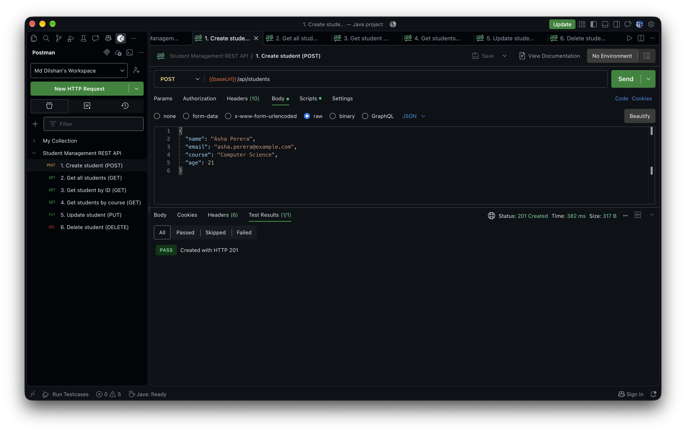
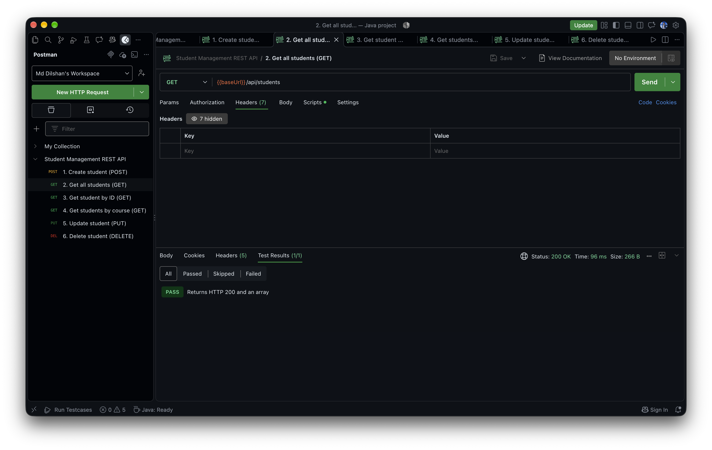
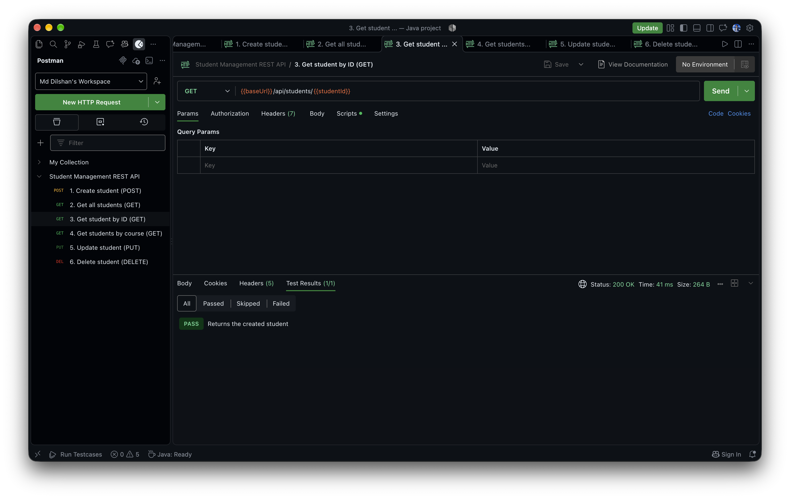
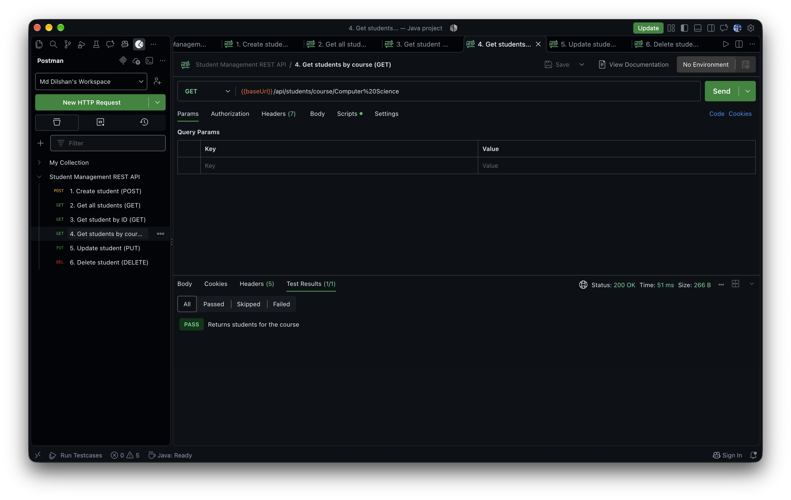
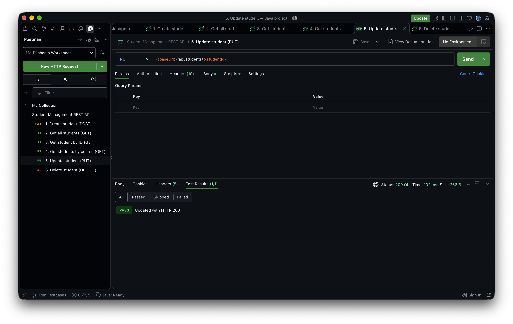
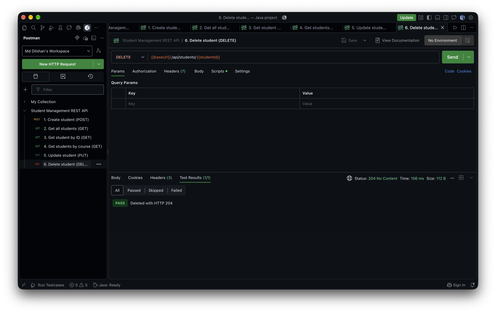
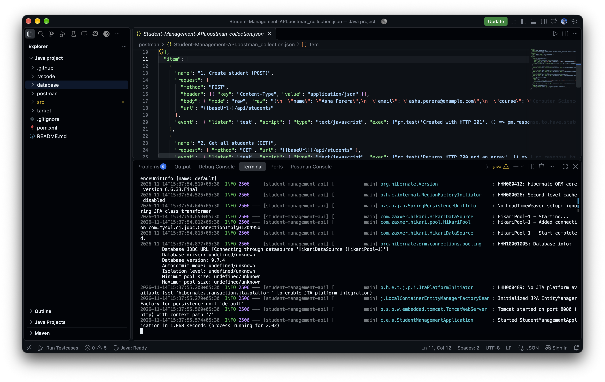

# Student Management REST API

A Spring Boot REST API using Spring Data JPA and MySQL. It implements all six endpoints in the assignment, validates request data, reports missing students as `404 Not Found`, and returns `409 Conflict` when an email address is already in use.

## Requirements

- Java 17 or newer
- Maven 3.6.3 or newer
- MySQL 8 or newer
- Postman (optional, to run the included collection)

## Database setup

Create the database with the included script:

```sh
mysql -u root -p < database/schema.sql
```

Set your MySQL credentials before starting the app. The defaults are username `root` and an empty password. For example:

```sh
export DB_USERNAME=root
export DB_PASSWORD=your_mysql_password
```

The connection URL can be overridden with `DB_URL`; by default it connects to `jdbc:mysql://localhost:3306/student_management`. Hibernate updates the table schema on startup.

## Run the API

```sh
mvn spring-boot:run
```

The API listens at `http://localhost:8080`. To build a runnable JAR:

```sh
mvn clean package
java -jar target/student-management-api-0.0.1-SNAPSHOT.jar
```

## Endpoints

| Method | Path | Result |
| --- | --- | --- |
| `POST` | `/api/students` | Create a student (`201 Created`) |
| `GET` | `/api/students` | List all students (`200 OK`) |
| `GET` | `/api/students/{id}` | Get one student (`200 OK`, or `404 Not Found`) |
| `PUT` | `/api/students/{id}` | Replace student details (`200 OK`, or `404 Not Found`) |
| `DELETE` | `/api/students/{id}` | Delete a student (`204 No Content`, or `404 Not Found`) |
| `GET` | `/api/students/course/{course}` | List students enrolled in a course (`200 OK`) |

Example request body for create and update:

```json
{
  "name": "Asha Perera",
  "email": "asha.perera@example.com",
  "course": "Computer Science",
  "age": 21
}
```

Names and courses cannot be blank, email must be valid and unique, and age must be between 1 and 150. Course lookup ignores letter case. Validation errors return `400 Bad Request` with a JSON error body.

## Postman

Import `postman/Student-Management-API.postman_collection.json` into Postman, start the application, then run the collection in order. The create request saves the generated ID for subsequent requests. It includes collection tests for the expected HTTP status and response shape. When using Postman in a browser, select the Postman Desktop Agent to send requests to `localhost`.

### API verification screenshots

The screenshots below show the Postman requests and passing checks for all six endpoints. The Spring Boot screenshot shows the application starting with its MySQL connection and listening on port 8080.

#### Create student



#### List all students



#### Get student by ID



#### Filter students by course



#### Update student



#### Delete student



#### Application startup



