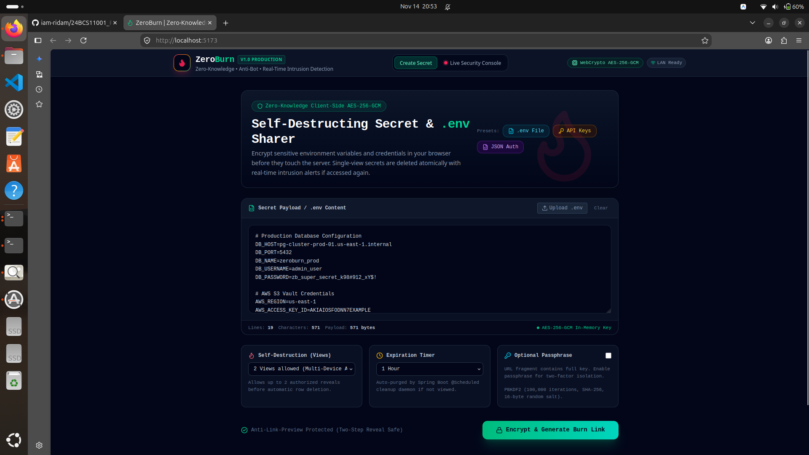
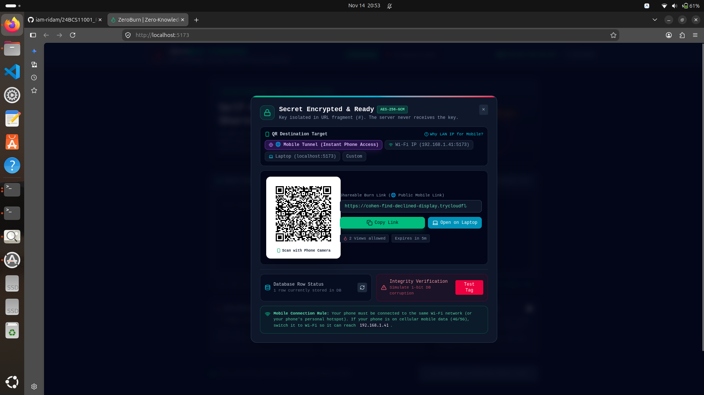

# 🔥 ZeroBurn — Zero-Knowledge, Self-Destructing Secret & .env File Sharer

[](https://openjdk.org/)
[](https://spring.io/projects/spring-boot)
[](https://react.dev/)
[](https://tailwindcss.com/)
[](https://www.postgresql.org/)
[](https://en.wikipedia.org/wiki/Galois/Counter_Mode)
[](LICENSE)

> **College Capstone / Engineering Project**  
> **ZeroBurn** is a production-grade, zero-knowledge ephemeral secret and `.env` file sharing platform. Engineered with client-side **AES-256-GCM** encryption, URL fragment key isolation (RFC 3986), atomic read-and-delete concurrency control in **Spring Boot & PostgreSQL**, two-step anti-link-preview protection, and real-time Server-Sent Events (SSE) intrusion detection.

---

## 📑 Table of Contents
1. [Project Overview & Motivation](#-project-overview--motivation)
2. [Why Spring Boot? (Backend Deep Dive)](#-why-spring-boot-backend-deep-dive)
3. [Zero-Knowledge Security Architecture](#-zero-knowledge-security-architecture)
4. [System Architecture Diagram](#-system-architecture-diagram)
5. [Key Technical Features](#-key-technical-features)
6. [Technology Stack](#-technology-stack)
7. [Getting Started (Step-by-Step Setup)](#-getting-started-step-by-step-setup)
8. [Zero-Config Fallback (H2 In-Memory Mode)](#-zero-config-fallback-h2-in-memory-mode)
9. [Mobile Demonstration & Cloudflare Tunnel](#-mobile-demonstration--cloudflare-tunnel)
10. [REST API Endpoints](#-rest-api-endpoints)

---

## 💡 Project Overview & Motivation

In modern software development teams, engineers routinely share sensitive secrets:
- `.env` files containing database passwords (`DB_PASSWORD`)
- Cloud infrastructure credentials (`AWS_SECRET_ACCESS_KEY`)
- API keys (`OPENAI_API_KEY`, `STRIPE_SECRET_KEY`)
- Private SSH and JWT signing keys

Too often, these credentials are sent over unencrypted or logged channels like WhatsApp, Slack, Teams, or plain email where they remain stored in chat history and backups forever.

**ZeroBurn solves this with a multi-layered security model:**
1. **Zero-Knowledge Guarantee:** The encryption key is generated in the browser and stored **only** in the URL hash fragment (`#key`). Per RFC 3986, browsers *never* transmit the hash fragment to the server. The backend and database only ever receive undecryptable ciphertext.
2. **Self-Destruction (Burn on Read):** As soon as an authorized recipient views the secret, its database record is atomically deleted.
3. **Anti-Link-Preview Bot Protection:** Automated crawlers (Slackbot, WhatsApp previewers) inspect links when pasted. ZeroBurn uses a two-step reveal protocol so bot requests never trigger premature destruction.
4. **Real-Time Intrusion Detection:** If anyone refreshes or visits an already-burned secret URL, Spring Boot immediately logs an intrusion attempt with their IP and device fingerprint, dispatching a live alert to the creator's dashboard via Server-Sent Events (SSE).





---

## 🍃 Why Spring Boot? (Backend Deep Dive)

The backend is built using **Java 21 LTS** and **Spring Boot 4.1.x**. Spring Boot was chosen as the enterprise foundation because it provides robust concurrency control, thread-safe transactional management, and high-performance reactive streaming out of the box:

### 1. Atomic Read-and-Delete Concurrency (Race Condition Defense)
When two users hit the burn endpoint simultaneously, standard "read-then-delete" code causes race conditions where both users read the secret before it is deleted. Spring Boot resolves this using two enterprise database concurrency mechanisms:
- **Single-View Secrets (`maxViews = 1`):** Executes an atomic native PostgreSQL statement:
  ```sql
  DELETE FROM secrets
  WHERE id = :id AND remaining_views = 1 AND expires_at > NOW()
  RETURNING *;
  ```
  PostgreSQL's row write lock guarantees that exactly one transaction deletes and returns the row. Any competing simultaneous request receives `0 rows` and is treated as an unauthorized intrusion.
- **Multi-View Secrets (`maxViews > 1`):** Managed via `@Transactional` with `@Lock(LockModeType.PESSIMISTIC_WRITE)` (`SELECT ... FOR UPDATE`), acquiring an exclusive row lock while decrementing `remaining_views`. When views reach `0`, the row is deleted immediately.

### 2. Real-Time Push Alerts via `SseEmitter` (Server-Sent Events)
Instead of relying on heavy WebSocket handshakes or aggressive client-side polling, Spring Boot's native `SseEmitter` maintains lightweight, persistent HTTP streams to creator browser sessions. 
- Heartbeat pings run every 15 seconds to prevent network timeouts.
- Thread-safe broadcast mechanisms deliver instant access alerts (`CREATED`, `VIEWED`, `CONSUMED`, `INTRUSION_ATTEMPT`) with sub-millisecond latency.

### 3. Background Expiration Daemon (`@Scheduled`)
Secrets that are never opened must not linger in the database. Spring Boot's task execution subsystem runs an asynchronous background cleanup task every 30 seconds (`@Scheduled(fixedRate = 30000)`):
```java
@Scheduled(fixedRate = 30000)
public void purgeExpiredSecrets() {
    secretService.purgeExpiredSecrets();
}
```
Expired records are purged and an `EXPIRED` audit event is logged.

### 4. Dual-Profile Database Architecture (Postgres + H2 Fallback)
Spring Boot's profile mechanism enables ZeroBurn to switch databases seamlessly without code changes:
- `application.yml` (Default): Production PostgreSQL 16/18 with native atomic SQL queries.
- `application-h2.yml` (Fallback): In-memory H2 database profile (`-Dspring-boot.run.profiles=h2`) for running in college lab PCs where PostgreSQL is not installed.

### 5. Automated LAN IP & Network Auto-Discovery
Spring Boot's `SystemController` inspects host network interfaces (`NetworkInterface.getNetworkInterfaces()`) to dynamically discover the machine's local Wi-Fi LAN IP (e.g. `192.168.1.x`) and any active Cloudflare tunnel URLs, automatically serving them to the frontend so mobile QR codes work out of the box.

---

## 🔐 Zero-Knowledge Security Architecture

```
 ┌─────────────────────────────────────────────────────────────────────────────────┐
 │                               CLIENT BROWSER (Sender)                           │
 │                                                                                 │
 │  1. User inputs sensitive payload (.env, API keys, credentials)                 │
 │  2. Generates 256-bit AES Key (K) + 96-bit random IV                            │
 │  3. [Optional] Derives Key from Passphrase (PBKDF2 100k rounds SHA-256)         │
 │  4. Encrypts payload client-side via AES-256-GCM (128-bit embedded auth tag)    │
 │  5. Generates URL Fragment: #{base64Url(K)}                                     │
 └─────────────────────────┬───────────────────────────────────────────────▲───────┘
                           │ POST /api/secrets                             │
                           │ Payload: { ciphertext, iv, salt, ... }        │ SSE Stream
                           │ (Decryption Key 'K' is NEVER sent!)          │ (Live Alerts)
                           ▼                                               │
 ┌─────────────────────────────────────────────────────────────────────────┴───────┐
 │                             SPRING BOOT 4.1 BACKEND                             │
 │                                                                                 │
 │  • Assigns UUID secretId                                                        │
 │  • Stores encrypted row in PostgreSQL                                           │
 │  • Pushes audit events over SseEmitter to creator session                       │
 │  • Atomic Read-and-Delete: DELETE FROM secrets ... RETURNING *                  │
 │  • Background @Scheduled daemon purges unconsumed expired secrets every 30s    │
 └─────────────────────────┬───────────────────────────────────────────────────────┘
                           │
                           ▼
 ┌─────────────────────────────────────────────────────────────────────────────────┐
 │                             POSTGRESQL DATABASE                                 │
 │                                                                                 │
 │  • Table 'secrets': Encrypted blobs only (deleted immediately upon consumption)  │
 │  • Table 'access_alerts': Audit trail (CREATED, CONSUMED, INTRUSION_ATTEMPT)    │
 └─────────────────────────────────────────────────────────────────────────────────┘
                           ▲
                           │
 ┌─────────────────────────┴───────────────────────────────────────────────────────┐
 │                          RECIPIENT BROWSER / MOBILE CLIENT                      │
 │                                                                                 │
 │  1. Opens URL: http://<LAN_IP>:5173/s/{secretId}#{key}                          │
 │  2. HTTP Request sends ONLY /s/{secretId} (Fragment '#' is strictly client-side)│
 │  3. Anti-Link-Preview check: GET /api/secrets/{id}/meta (non-destructive)       │
 │  4. User clicks "Burn & Reveal Secret" -> POST /api/secrets/{id}/consume        │
 │  5. Decrypts locally: Web Crypto API or pure-JS noble fallback                  │
 │  6. Clipboard Auto-Wipe: copies payload and overwrites clipboard after 30s      │
 │  7. If reloaded: Database row is 0 -> Logs INTRUSION_ATTEMPT to sender console! │
 └─────────────────────────────────────────────────────────────────────────────────┘
```

---

## 🌟 Key Technical Features

1. **RFC 3986 URL Fragment Isolation:** The decryption key lives exclusively behind `#`. The web server never sees the decryption key in HTTP headers or access logs.
2. **Dual-Mode Cryptographic Fallback:**
   - **Primary:** Browser hardware-accelerated `window.crypto.subtle` (AES-256-GCM).
   - **Fallback:** Pure-JS `@noble/ciphers` + `@noble/hashes` for non-HTTPS local IP origins (e.g. `http://192.168.x.x`), ensuring smooth mobile phone demonstrations over Wi-Fi without SSL certificate warnings.
3. **Cryptographic Tamper Detection:** AES-256-GCM embeds a 128-bit authentication tag. If an attacker modifies even 1 bit of ciphertext in PostgreSQL, client decryption immediately throws an `IntegrityCheckError` and aborts.
4. **Auto-Wiping Clipboard (30s):** Decrypted secrets copied to the clipboard are automatically overwritten with empty strings after 30 seconds with a visual countdown timer.
5. **Interactive Developer Console:** Real-time audit log, synthesized Web Audio alarm for intrusions, and downloadable JSON audit reports.

---

## 🛠️ Technology Stack

| Component | Technology | Version | Purpose |
| :--- | :--- | :--- | :--- |
| **Backend Framework** | Spring Boot | 4.1.2 | REST Controller, Service Layer, Concurrency |
| **Language Runtime** | Java LTS | 21 | Virtual threads, record types, modern syntax |
| **Data Access** | Spring Data JPA / Hibernate | 6.x | Pessimistic locking, entity mapping, native queries |
| **Primary Database** | PostgreSQL | 18 / 16 | ACID transactional database, atomic deletes |
| **Fallback Database** | H2 Database | 2.x | In-memory zero-config embedded database |
| **Real-Time Push** | Server-Sent Events | `SseEmitter` | Bi-directional streaming of intrusion alarms |
| **Frontend Library** | React | 19.x | Modern UI components & state management |
| **Build Tool** | Vite | 6.x | ESM development server and production bundler |
| **CSS Framework** | Tailwind CSS | v4 (`@tailwindcss/vite`) | Dark-mode terminal/vault design |
| **Cryptography** | Web Crypto API + `@noble/ciphers` | 1.x | Client-side AES-256-GCM & PBKDF2 |
| **Icons** | Lucide React | Latest | Clean cybersecurity UI icons |

---

## 🚀 Getting Started (Step-by-Step Setup)

### Prerequisites
- **Java 21+** (`java -version`)
- **Node.js 18+** (`node -v`)
- **PostgreSQL 14+** (or use the built-in H2 in-memory profile)

---

### Method 1: The Automated 1-Command Startup (Linux / macOS)

We have provided a comprehensive startup script that starts PostgreSQL, the Spring Boot backend, the Vite frontend, and the Cloudflare mobile tunnel with one command:

```bash
cd /path/to/project
./run.sh
```

The script will launch all components and display the clickable URLs in your terminal:
```text
==========================================================
  ✅ ZeroBurn is LIVE!
  💻 Laptop Browser:   http://localhost:5173
  📱 Mobile Wi-Fi IP:  http://192.168.1.39:5173
  🌐 Mobile (Anywhere): https://your-tunnel.trycloudflare.com
==========================================================
```
*(Press `Ctrl + C` in the terminal to cleanly terminate all processes).*

---

### Method 2: Manual Step-by-Step Startup

#### 1. Database Setup (PostgreSQL)
Ensure PostgreSQL is running and create the user and database:
```sql
CREATE USER postgres WITH PASSWORD 'postgres';
CREATE DATABASE zeroburn OWNER postgres;
```

#### 2. Start Spring Boot Backend
```bash
cd backend
./mvnw clean spring-boot:run
```
*(On Windows Command Prompt, run: `mvnw.cmd clean spring-boot:run`)*  
The Spring Boot backend will start on **`http://localhost:8080`**.

#### 3. Start Vite Frontend
In a new terminal window:
```bash
cd frontend
npm install
npm run dev
```
The React frontend will start on **`http://localhost:5173`**.

Open **`http://localhost:5173`** in your browser!

---

## 🧪 Zero-Config Fallback (H2 In-Memory Mode)

If presenting on a college lab computer or demo PC where PostgreSQL is not installed, launch Spring Boot using the embedded H2 profile:

**Linux / macOS:**
```bash
cd backend
./mvnw spring-boot:run -Dspring-boot.run.profiles=h2
```

**Windows:**
```cmd
cd backend
mvnw.cmd spring-boot:run -Dspring-boot.run.profiles=h2
```

The backend starts instantly using an in-memory database with zero installation required!

---

## 📱 Mobile Demonstration & Cloudflare Tunnel

During college demonstrations, college/hostel Wi-Fi routers frequently have **AP Isolation (Client Isolation)** enabled, preventing phones from reaching a laptop's local IP (`192.168.1.x`).

ZeroBurn solves this with two built-in solutions:
1. **Automated Cloudflare Quick Tunnel:**  
   ZeroBurn automatically generates a secure public HTTPS link (e.g. `https://xxxx.trycloudflare.com`). The QR code on your laptop encodes this URL so any phone camera can scan it and load the app over 4G/5G mobile data or Wi-Fi.
2. **Mobile Hotspot Trick:**  
   If you have no internet access, turn on your phone's personal hotspot and connect your laptop to it. Phone hotspots never isolate clients, allowing direct access over `http://192.168.43.x:5173`.

---

## 📡 REST API Endpoints

| HTTP Method | Endpoint | Description |
| :--- | :--- | :--- |
| `POST` | `/api/secrets` | Stores encrypted payload `{ ciphertext, iv, salt, maxViews, expiryMinutes }`. Returns `secretId`. |
| `GET` | `/api/secrets/{id}/meta` | Non-destructive check returning metadata (`remainingViews`, `expiresAt`, `hasPassphrase`). |
| `POST` | `/api/secrets/{id}/consume` | Atomically decrements view count or deletes row. Returns ciphertext for client decryption. |
| `POST` | `/api/secrets/{id}/simulate-tamper` | Modifies 1 byte in PostgreSQL to test AES-256-GCM authentication tag failure. |
| `GET` | `/api/secrets/{id}/row-count` | Returns live PostgreSQL row count (proves 0 rows after burn). |
| `GET` | `/api/alerts/stream` | Server-Sent Events (SSE) stream for live access and intrusion alerts. |
| `GET` | `/api/system/network-info` | Returns host LAN IP and active tunnel URLs for dynamic QR generation. |

---
